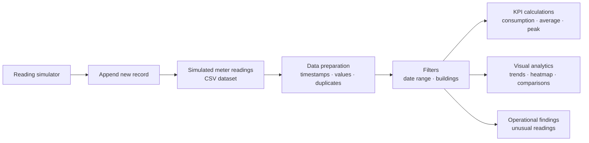

<div align="center">

<a href="https://github.com/Dixith-ai/campus-energy-intelligence-streamlit" target="_blank" rel="noopener noreferrer">
  
</a>

<br>

<a href="https://campus-energy-intelligence-app.streamlit.app" target="_blank" rel="noopener noreferrer">
  
</a>
<a href="https://github.com/Dixith-ai/campus-energy-intelligence-streamlit" target="_blank" rel="noopener noreferrer">
  
</a>

<br><br>

<a href="https://www.python.org/" target="_blank" rel="noopener noreferrer"></a>
<a href="https://streamlit.io/" target="_blank" rel="noopener noreferrer"></a>
<a href="https://plotly.com/python/" target="_blank" rel="noopener noreferrer"></a>


<br><br>


<br>

**An interactive campus energy analytics dashboard.**

[Live dashboard](https://campus-energy-intelligence-app.streamlit.app) · [Source code](https://github.com/Dixith-ai/campus-energy-intelligence-streamlit) · [Overview](#overview) · [Dashboard intelligence](#dashboard-intelligence) · [Data logic](#data-logic) · [Run locally](#run-locally) · [Limitations](#limitations)

</div>

---

<div align="center">

### THE CAMPUS, THROUGH ITS ENERGY DATA

</div>

## `01` / Overview

Campus Energy Intelligence is an interactive dashboard for exploring electricity consumption across campus buildings. It brings building comparisons, time-based analysis, demand patterns, data-quality checks and simulated data ingestion into one interface.

The idea is simple: move beyond a table of meter readings and make the underlying operational patterns easier to see.

<table>
<tr>
<td width="33%" align="center">
<h2>05</h2>
<strong>Campus buildings</strong><br>
<sub>Building-level comparison</sub>
</td>
<td width="33%" align="center">
<h2>1,683</h2>
<strong>Sample readings</strong><br>
<sub>Demonstration dataset</sub>
</td>
<td width="33%" align="center">
<h2>24</h2>
<strong>Hourly slots</strong><br>
<sub>Daily completeness standard</sub>
</td>
</tr>
</table>

> [!IMPORTANT]
> **SIMULATED ENVIRONMENT** — This is an academic prototype using synthetic readings. It is not connected to physical electricity meters, a building management system, or a utility provider. All values and findings are illustrative, not live campus measurements.

## `02` / Dashboard intelligence

Different visual forms answer different operational questions.

<table>
<tr>
<td width="50%" valign="top">

### CONSUMPTION TRAJECTORY

Daily energy totals across the selected reporting window. Complete days form the trend; partial observations are distinguished rather than presented as full-day totals.

</td>
<td width="50%" valign="top">

### BUILDING ENERGY MIX

A proportional view of how selected-period energy consumption is distributed across campus buildings.

</td>
</tr>
<tr>
<td width="50%" valign="top">

### DEMAND INTENSITY MAP

A date-by-hour heatmap retaining observed readings and labelling partial and missing days.

</td>
<td width="50%" valign="top">

### CONSUMPTION HIERARCHY

A treemap that makes differences in building-level consumption immediately visible.

</td>
</tr>
<tr>
<td width="50%" valign="top">

### PEAK DEMAND GAUGE

A focused view of the highest recorded demand in the current selection.

</td>
<td width="50%" valign="top">

### ENERGY / DEMAND RELATIONSHIP

A scatter plot for exploring how interval energy and recorded demand move together.

</td>
</tr>
<tr>
<td width="50%" valign="top">

### TYPICAL HOURLY DEMAND

An hourly demand profile calculated from complete days only.

</td>
<td width="50%" valign="top">

### OPERATIONAL FINDINGS

A data-supported observation that helps identify where further investigation may be useful.

</td>
</tr>
</table>

## `03` / The indicators

<div align="center">

<table>
<tr>
<td align="center" width="25%">
<sub>01 / ENERGY</sub>
<h2>kWh</h2>
<strong>Total consumption</strong>
<br><sub>Sum of readings in the selected window.</sub>
</td>
<td align="center" width="25%">
<sub>02 / DAILY BASELINE</sub>
<h2>kWh/day</h2>
<strong>Daily average</strong>
<br><sub>Mean across complete days only.</sub>
</td>
<td align="center" width="25%">
<sub>03 / DEMAND</sub>
<h2>kW</h2>
<strong>Peak demand</strong>
<br><sub>Highest recorded demand value.</sub>
</td>
<td align="center" width="25%">
<sub>04 / COVERAGE</sub>
<h2>Sites</h2>
<strong>Active buildings</strong>
<br><sub>Selected buildings represented in the data.</sub>
</td>
</tr>
</table>

</div>

## `04` / How the data moves

The dashboard follows a straightforward data path: read the CSV, validate and filter the records, calculate indicators, then render interactive views.



## `05` / Data logic

A dashboard should make data quality visible instead of hiding it.

### Completeness standard

A day is complete when **each selected building has readings in 24 distinct hourly slots**.

| Rule | Treatment |
|:--|:--|
| Multiple readings in one hour | Count as one distinct hourly slot |
| Complete day | Included in daily average and typical hourly profile |
| Partial day | Actual observations remain visible and are labelled |
| No readings | Identified separately from partial days |
| Data coverage | Distinct hourly slots, capped at 24 per selected building per day |

### Validation checks

- Timestamp parsing and numeric conversion.
- Removal of rows with missing required values.
- Duplicate handling for building-and-timestamp records.
- Rejection of negative energy and demand values.
- Record-status retention to distinguish ordinary simulated readings from manually added demonstration records.

### Anomaly screening

Unusual readings are screened using a building-and-hour median/MAD baseline with a minimum lift threshold.

A flagged reading is a prompt for investigation. It is not proof of equipment failure, energy waste or a safety issue.

## `06` / Technology

<div align="center">

| APPLICATION | DATA | VISUALIZATION |
|:---:|:---:|:---:|
| Python · Streamlit | Pandas · NumPy · CSV | Plotly |

</div>

| Technology | Responsibility |
|:--|:--|
| **Python** | Application logic and calculations |
| **Streamlit** | Interactive dashboard interface |
| **Pandas** | Data loading, filtering, grouping and validation |
| **NumPy** | Numerical and statistical operations |
| **Plotly** | Interactive visualizations |
| **CSV** | Portable demonstration data storage |

## `07` / Live deployment

The dashboard is published through Streamlit Community Cloud.

**Open the application:** [campus-energy-intelligence-app.streamlit.app](https://campus-energy-intelligence-app.streamlit.app)

The deployed application runs in a cloud environment. Its filesystem is separate from the copy on a developer's laptop, so editing the local CSV does not automatically update the hosted dashboard. The in-app simulated reading workflow demonstrates the application's data-update logic; persistence on the hosted instance should not be treated as a production database.

## `08` / Run locally

### Requirements

- Python 3.10 or later
- pip
- Project files and the CSV dataset

### Project structure

```text
campus-energy-intelligence-streamlit/
│
├── app.py
├── requirements.txt
├── README.md
├── submission_explanation.md
├── dashboard_preview.png
│
└── data/
    └── energy_readings.csv
```

### Launch

```bash
# Install dependencies
pip install -r requirements.txt

# Start the dashboard
streamlit run app.py
```

Open the local address printed by Streamlit, usually:

```text
http://localhost:8501
```

## `09` / Live demonstration — simulated ingestion

The dashboard includes a meter-reading form for demonstrating how new data changes the interface.

1. Expand **Add a new simulated meter reading**.
2. Select a campus building.
3. Enter energy consumed in kWh and demand in kW.
4. Choose the reading date and time.
5. Select **Save reading and refresh dashboard**.

The application writes the new record to `data/energy_readings.csv`, reloads the dataset and recalculates the dashboard.

> [!NOTE]
> The workflow writes to the application's CSV file. It demonstrates a data update, not a live meter feed, cloud database or concurrent multi-user ingestion service. On the hosted deployment, the cloud runtime is separate from your local computer; local CSV edits do not sync to it.

## `10` / Interpreting the findings

The dashboard identifies the building with the largest share of consumption in the current selection. This can help facilities staff decide where to review operating schedules and major electrical loads.

A higher consumption share does not automatically mean a building is inefficient. Building size, operating hours and equipment mix influence demand. Context is required before recommending corrective action.

## `11` / Limitations

- All readings are synthetic and do not represent measured campus consumption.
- No smart meters, IoT devices, building management systems or utility APIs are connected.
- Hourly completeness assumes 24 expected slots per building per day.
- Local CSV storage is suitable for a controlled classroom demonstration, not concurrent production ingestion.
- Statistical anomaly flags require human review and are not confirmed faults.
- Findings depend on the selected reporting period, buildings and quality of the supplied records.

---

<div align="center">


### MEASURE THE LOAD. UNDERSTAND THE PATTERN.

**CAMPUS ENERGY INTELLIGENCE**

<sub>Academic prototype · Interactive analytics · Simulated campus energy dataset</sub>

<br><br>


</div>
